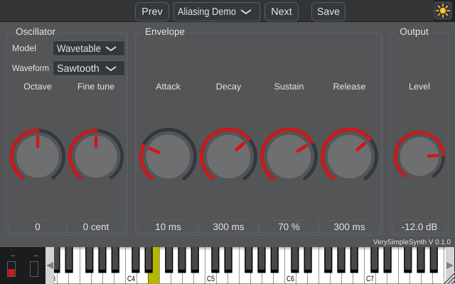

# VerySimpleSynth

A very simple monophonic synthesizer for teaching: one oscillator, one ADSR envelope -- and a switch between nine
ways to build the oscillator (naive, wavetable, wavetable with Lanczos sigma, polyBLEP, 4-point polyBLEP, minBLEP, BLIT,
DPW, oversampling), so you
can hear, see and measure aliasing and the side effects of each method. A large view shows the oscilloscope (1 or 2
periods) or, on its second page, the spectrum.



## Features
* One oscillator: waveform Sine, Triangle, Rectangle, Sawtooth; Octave (-3..+3) and Fine tune (+-100 cent)
* Oscillator model (the teaching part):
  * **Naive**: the ideal waveform, sampled. Simple, but with strong aliasing for high notes.
  * **Wavetable**: band-limited tables (Fourier series, one table per octave), linear interpolation.
  * **Wavetable + Lanczos**: the same with Lanczos sigma factors: the Gibbs overshoot at the jumps drops from 9 % to
    about 1 %.
  * **PolyBLEP**: the naive waveform with polynomial corrections at jumps (polyBLEP) and corners (polyBLAMP).
  * **PolyBLEP 4-point**: the same with a cubic B-spline over 4 samples.
  * **minBLEP**: minimum-phase corrections from a table (no pre-ringing, but a small delay).
  * **BLIT**: leaky integration of band-limited impulse trains.
  * **DPW**: differentiated antiderivative (the mean over one sample).
  * **Oversampling 8x**: naive at 8 fs, low-pass filter, decimation.
* Oscilloscope: 1 or 2 periods of the oscillator (before the envelope), triggered at the start of a period, with the
  ideal waveform and the sample points
* Spectrum (second page): FFT of the oscillator, linear frequency axis, marks at the harmonics -- every peak between
  them is aliasing -- and the live value "energy outside the harmonics"
* Linear ADSR envelope, velocity, pitch bend (+-2 semitones), output level
* MIDI input; on-screen keyboard with pitch and mod wheel
* Presets (preset bar) with 16 factory presets and "Init" (always the default values; it is written again at every
  start, so save your own sounds under another name), among them one sawtooth per model, "Aliasing Demo", and
  "Gibbs Demo" / "Lanczos Demo" for the comparison
* Day/night theme, resizable window
* VST3, AU (macOS) and Standalone

Monophonic with last-note priority: hold a key, press another one, release it -- the first one sounds again.

### Try it
* Load "Aliasing Demo" and play a scale in the upper octaves: with the model Naive you hear extra tones that do not
  belong to the note (they even fall when the pitch rises). Switch through the models: they are gone or weaker.
* Load "Gibbs Demo" and play C5: the oscilloscope shows the ringing at the jumps. Choose "Wavetable + Lanczos".
* Choose PolyBLEP and a high note: the dots show that only the samples next to a jump are changed.
* Open the Spectrum page, play C7 and step through the models: watch the peaks between the harmonic marks and the
  value "outside the harmonics".

Measured energy outside the harmonics (sawtooth, note C7 = 2093 Hz, 48 kHz, `tools/analysis/measure_models.py`):

| Naive | DPW | PolyBLEP | Oversampling 8x | PolyBLEP 4-point | BLIT | minBLEP | Wavetable |
|---|---|---|---|---|---|---|---|
| -13 dB | -23 dB | -29 dB | -32 dB | -38 dB | -84 dB | -85 dB | -86 dB |

## Controls
| Control | Range | Default | Description |
|---|---|---|---|
| Model | Naive - Oversampling 8x | Naive | How the oscillator makes the waveform: Naive (sampled ideal waveform, aliasing), Wavetable (band-limited tables, one per octave), Wavetable + Lanczos (harmonics weighted with Lanczos sigma factors: less overshoot at jumps), PolyBLEP and PolyBLEP 4-point (naive waveform with polynomial corrections at jumps and corners), minBLEP (minimum-phase corrections from a table), BLIT (integrated band-limited impulse trains), DPW (differentiated antiderivative), Oversampling 8x (naive at 8 fs, filtered). |
| Waveform | Sine - Sawtooth | Sawtooth | The waveform of the oscillator (Rectangle: 50 % duty cycle). |
| Octave | -3 - 3 | 0 | Shifts the pitch by whole octaves. |
| Fine tune | -100 cent - 100 cent | 0 cent | Fine tuning in cent (100 cent = 1 semitone). |
| Attack | 1 ms - 5000 ms | 10 ms | Time to rise to full level after a key is pressed. |
| Decay | 1 ms - 5000 ms | 300 ms | Time to fall from full level to the sustain level. |
| Sustain | 0 % - 100 % | 70 % | Level while the key is held (in % of full level). |
| Release | 1 ms - 5000 ms | 300 ms | Time to fall to silence after the key is released. |
| Level | -60.0 dB - 0.0 dB | -12.0 dB | Output level (at velocity 127). |

(generated with `VerySimpleSynth_Tester --manual md`)

## The code
| File | What |
|---|---|
| `oscillators/` | the oscillator models, one file each -- start reading with `Oscillator.h` |
| `SimpleEnvelope.h/.cpp` | the linear ADSR |
| `VerySimpleSynth.h/.cpp` | parameters, MIDI handling (note stack, pitch bend), rendering, GUI |
| `ScopeCapture.h/.cpp`, `Oscilloscope.h/.cpp` | recording (audio thread) and display (GUI) of the oscilloscope |
| `SpectrumCapture.h/.cpp`, `Spectrum.h/.cpp` | FIFO (audio thread) and FFT display (GUI) of the spectrum |
| `tools/analysis/measure_models.py` | measures aliasing, overshoot and phase of all models (numpy) |
| `res/presets/` | factory presets |
| `planning.md` | decisions, how the models work, test results, ideas how to go on |

The plugin is made from the [AdvancedAudioTemplate](https://github.com/JoergBitzer/AdvancedAudioTemplate)
(branch AAT2); its README is in `docs/AAT2_README.md`, the test tools in `HowToTestYourPlugin.md`.

## Build
```console
git submodule update --init
cmake -S . -B build -DCMAKE_BUILD_TYPE=Release
cmake --build build --config Release --target VerySimpleSynth_VST3 VerySimpleSynth_Standalone
```

## License
The source code is under the MIT License (`LICENSE`). JUCE is used under the AGPLv3, so the plugin binaries as a
whole are under the AGPLv3 (`LICENSE-AGPL-3.0.txt`).
